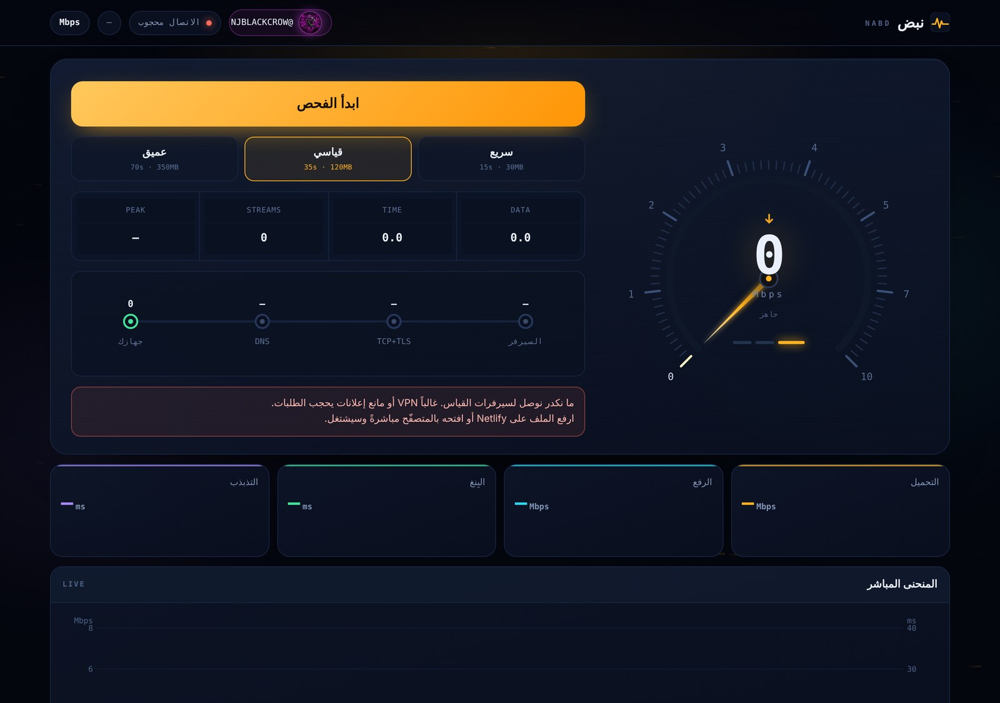

# نبض · NABD

A browser-based internet speed test in Arabic (RTL), built as one self-contained
page. It measures download, upload and latency, but it is built around the parts
most speed tests skip: **ping under load**, **ISP throttling detection**, and a
**local-vs-international path comparison**.

Live: **[nabdnet.netlify.app](https://nabdnet.netlify.app)**



---

## Why another speed test

A single "download Mbps" number hides the things that actually make a connection
feel slow. نبض measures those directly:

- **Ping under load.** Latency is measured while the line is saturated, not on an
  idle connection, so you see the bufferbloat that breaks calls and games.
- **Throttling detection.** It compares how the line behaves on one connection vs.
  many parallel ones, which exposes per-stream shaping some ISPs apply.
- **Local vs. international path.** It separates the speed to a nearby route from the
  speed to an international one, so you can tell a local-cache result from your real
  cross-border throughput.
- **Live detail, not just a final number.** A live gauge and per-metric panels
  (download, upload, ping, jitter) update through the run, with a verdict and a
  short plain-language read of what the numbers mean for streaming, calls and games.

Test lengths: quick (~15s), standard (~35s), deep (~70s).

## Built for the real web

- **One file.** The whole app is a single `index.html` — no build step, no backend,
  no tracking.
- **Installable (PWA).** Web app manifest and icons, so it installs to a phone home
  screen and opens full-screen.
- **Hardened headers.** A strict Content-Security-Policy and the usual security
  headers ship with it (`_headers`, `netlify.toml`).
- **Arabic-first.** Fully right-to-left, written in natural Arabic, not translated.

## Run it

It is a static site. Any static host or a local server works:

```bash
python3 -m http.server 8000
# then open http://127.0.0.1:8000
```

Opening `index.html` straight from disk also renders, but the measurement needs a
real `https` origin (a VPN or an ad-blocker can block the test requests).

### Deploy

It is set up for [Netlify](https://www.netlify.com) (`netlify.toml` publishes the
folder as-is), but it drops onto GitHub Pages, Cloudflare Pages or any static host
without changes.

## Files

```
index.html             the whole app (UI + measurement engine)
manifest.webmanifest   PWA manifest
icon-192 / icon-512    app icons   ·   apple-touch-icon, favicon-32
og.png                 social preview image
_headers, netlify.toml security headers + Netlify config
robots.txt, sitemap.xml, 404.html
```

## Credit

Built by **Nizar Jasim Mohammed Al-Zubaidi** ([@NizarJasim1](https://github.com/NizarJasim1)),
branded with the [NJ BLACK CROW](https://t.me/NJBLACKCROW) channel.

## License

[MIT](LICENSE).
